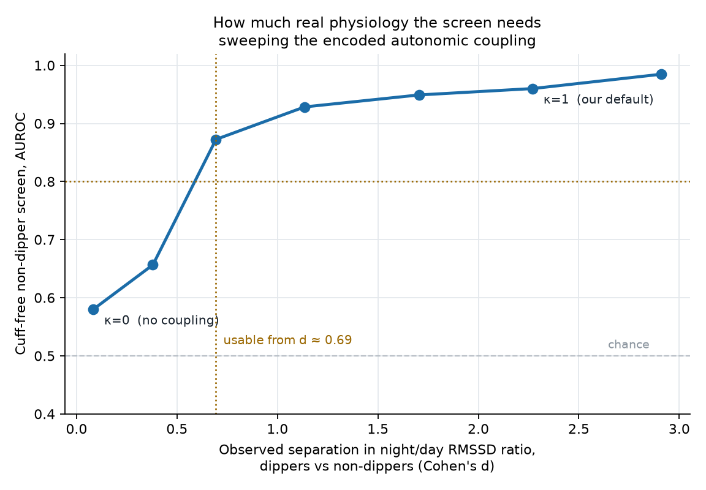
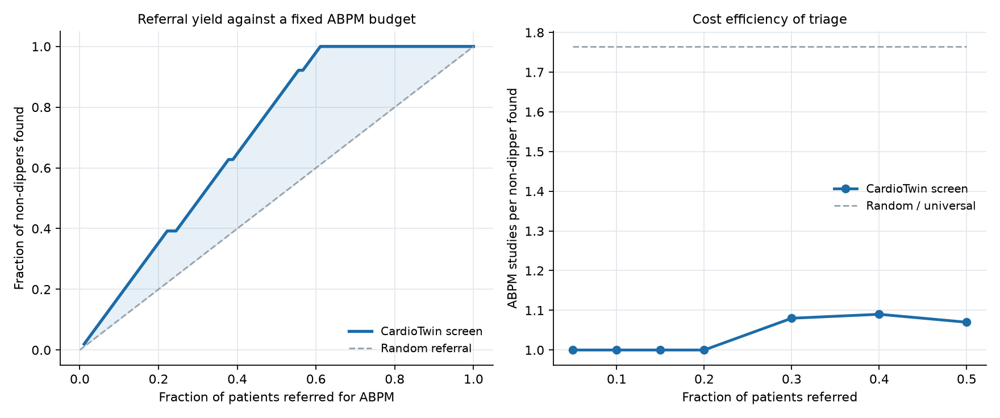

# CardioTwin

**A hypertension digital twin that simulates interventions, not just risk.**

Submission to the **Digital Twin Challenge 2026**, Happiest Health · Reimagining and Reforming Healthcare in India Summit, Bengaluru.

> **Synthetic data only. Research prototype. Not a medical device.**
> No real patient data is used anywhere in this repository. Nothing here should be used to make a clinical decision.

---

## 1. Team details and college / incubator information

| | |
|---|---|
| **Team name** | nj24csb0a50 |
| **College / institute** | National Institute of Technology, Warangal (NITW) |
| **Incubator** | Not affiliated |
| **Team leader** | Nihal J N — B.Tech Computer Science and Engineering, 3rd year |
| **Member** | Neelam Jashwanth — B.Tech Computer Science and Engineering, 3rd year |

*Leader contact details are supplied on the Unstop submission form rather than published in this repository.*

---

## 2. Project title

**CardioTwin — a cuff-free digital twin for nocturnal hypertension risk in India.**

---

## 3. Problem statement and healthcare use case

**315 million Indian adults live with hypertension** (ICMR-INDIAB, *Lancet Diabetes & Endocrinology*, 2023). Almost none of them get the test that matters most.

Blood pressure follows a circadian rhythm and should fall 10–20% overnight. Patients whose pressure does not fall are **non-dippers**; those whose pressure *rises* at night are **reverse dippers**. Non-dipping predicts cardiovascular events independently of the daytime reading, and it is invisible to a clinic measurement.

Confirming the phenotype requires **24-hour ambulatory blood pressure monitoring (ABPM)**. ABPM is scarce, costly and largely confined to urban private care in India, so the overwhelming majority of those 315 million people are managed on clinic readings that cannot see their highest-risk feature.

Meanwhile, the wrist is already instrumented. Consumer wearables continuously measure heart rate, heart rate variability, sleep architecture and activity. They cannot measure blood pressure.

**The use case this project addresses:** use what a wearable *can* measure, fused with the patient's existing health record, to decide **who needs the cuff** — and then give the clinician a twin they can run interventions against before changing a prescription.

### What the twin does

1. **Screens** for the non-dipper phenotype from cuff-free wearable signal alone.
2. **Predicts** a sustained Stage-2 hypertensive excursion (SBP ≥ 160 mmHg for ≥ 30 min) in the next 24 hours.
3. **Simulates** five clinical interventions on a personalised mechanistic model and reports the predicted change in 24-hour and night-time pressure.

---

## 4. Technical stack, AI/ML model and framework details

### Stack

| Layer | Choice |
|---|---|
| Language | Python 3.11+ |
| Data | `numpy`, `pandas`, `pyarrow` |
| Modelling | `xgboost`, `scikit-learn` (isotonic calibration, grouped splits) |
| Simulation | Custom mechanistic circadian cardiovascular model (`numpy`) |
| Figures | `matplotlib` |
| Dashboard | Single self-contained HTML file, vanilla JS, inline SVG — no server, no CDN, no build step |
| Documents | HTML rendered to PDF via headless Chromium (`playwright`) |

### The two data streams the brief requires

| Stream | Content | Resolution |
|---|---|---|
| **Static / historical EHR** | Demographics, urban/rural, ICD-10 problem list (I10, E11.9, N18.3, G47.33, E78.5, I21.9, I63.9), labs (creatinine, eGFR, HbA1c, LDL, Na, K, UACR), antihypertensive regimen with dose timing, polygenic risk score proxy | 1 record / patient |
| **Dynamic / wearable** | Heart rate, HRV (RMSSD), sleep stage (wake/light/deep/REM), step count, blood pressure | **5 minutes**, 21 days |

**Cohort: 300 virtual patients × 21 days = 1,814,400 samples.**

### The simulator

Data is generated by a mechanistic model, not sampled noise. Four pieces of established cardiovascular physiology are encoded:

1. **Circadian BP rhythm** with a dipping phenotype (dipper / non-dipper / reverse dipper).
2. **Morning surge** on waking, exaggerated in non-dippers.
3. **Autonomic coupling** — RMSSD rises overnight with parasympathetic tone, and that rise is blunted in non-dippers, OSA and diabetic autonomic neuropathy.
4. **Steady-state pharmacodynamics** per agent, so a missed or badly timed dose is visible in the trace.

**Face validity.** The simulator was never given the clinical cut-off, yet the phenotypes it produces land exactly where the definitions sit:

| Phenotype | Mean nocturnal SBP fall | Clinical definition |
|---|---|---|
| Dipper | **15.7%** | 10–20% fall |
| Non-dipper | **5.9%** | < 10% fall |
| Reverse dipper | **−2.6%** | rise at night |

### Models

- **Risk model** — XGBoost (380 trees, depth 4, lr 0.045) wrapped in `CalibratedClassifierCV` with isotonic calibration. 76 features: 22 static, 54 dynamic (7-day mean / last value / linear trend for each of 17 daily constructs). Patient-grouped train/test split so no patient appears in both.
- **Non-dipper screen** — identical pipeline, patient-level scoring, cuff-free inputs only.
- **The twin** — a reduced mechanistic model personalised per patient from one calibration week:

  ```
  SBP(t) = S · circ(t; night_f) + surge(t; A) + behaviour(t) − med(t) + ε
  ```

  Setpoint `S`, nocturnal factor `night_f` and surge amplitude `A` are fitted from the patient's own trace. Behaviour coefficients are estimated once across the cohort by **within-patient** regression on observed data. The twin never reads the simulator's latent traits.

### Clinically meaningful features (not raw statistics)

`dip_ratio` (nocturnal fall) · `morning_surge` · `hrv_night_ratio` (nocturnal vagal rise) · `arv_sbp` (average real variability) · `sleep_debt` · `deep_frac` · layer of 7-day trends

**Cuff-derived channels are held out of the headline model.** Most Indian hypertensive patients own no cuff, so `sbp_*`, `dbp_*`, `dip_ratio`, `morning_surge`, `arv_sbp` and recent-event counts are excluded from the model we actually propose. They are used only in a labelled reference arm.

---

## 5. Results

<!-- AUTOGEN:RESULTS:START -->

Patient-grouped split. 90 held-out patients, 1260 patient-days, prevalence 30%. Bootstrap CIs resampled by patient.

> Produced on Darwin arm64, Python 3.14.0, xgboost 3.4.1, scikit-learn 1.8.0. Regenerate with `./run_all.sh && python3 src/report.py`.

### Result 1 — the negative one, reported as such

Predicting a next-24h Stage-2 excursion:

| Model | AUROC | 95% CI | AUPRC | Brier |
|---|---|---|---|---|
| EHR only | 0.637 | 0.528–0.731 | 0.473 | 0.198 |
| Cuff-free wearable only | 0.517 | 0.433–0.599 | 0.315 | 0.211 |
| **Fused, cuff-free** | **0.642** | 0.550–0.725 | 0.462 | 0.197 |
| *Reference: with BP cuff* | *0.882* | *0.836–0.918* | *0.835* | *0.107* |
| *Baseline: yesterday's mean SBP* | *0.884* | *0.839–0.920* | — | — |

**Fusing cuff-free wearable data with the record is indistinguishable from the record alone**: 0.642 against 0.637, intervals overlapping almost entirely. If a cuff is available, use it. A one-line rule on yesterday's reading already scores 0.884. **Forecasting tomorrow's pressure from the wrist is not the product**, and we say so rather than burying it.

### Result 2 — the one that matters

Same cuff-free inputs, different question: *does this patient's pressure fail to fall at night?*

| | |
|---|---|
| **Non-dipper screen, cuff-free, patient-level** | **AUROC 0.960** (95% CI 0.911–0.998), n = 90 held-out patients |

The signal is autonomic: the night/day RMSSD ratio carries the phenotype with no pressure measurement anywhere in the input. That turns a scarce test (ABPM) into a triage decision, on hardware tens of millions of Indians already wear.

### Result 3 — the twin, measured

Twin predicts a change; the ground-truth simulator is re-run for the **same virtual patient, same random seed, same override**. Paired, 120 patients, no selection.

| Intervention | true Δ24h | twin Δ24h | MAE | true Δnight | twin Δnight | sign |
|---|---|---|---|---|---|---|
| Increase activity by 30% | -0.64 | -0.47 | 0.17 | -0.96 | -0.47 | 100% |
| Move one agent to 21:00 dosing | +0.10 | +0.01 | 0.09 | **-1.75** | -2.58 | 99% |
| Perfect medication adherence | -2.16 | -2.31 | 1.53 | -1.73 | -1.90 | 90% |
| Reduce salt by 3 g/day | -2.85 | -2.85 | 0.00 | -2.85 | -2.85 | *circular* |
| Extend sleep by 1 hour | -0.50 | -0.78 | 0.65 | +0.03 | -0.78 | 74% |

**Chronotherapy is the showcase.** Moving one agent to bedtime changes the 24-hour mean by essentially nothing (+0.10 mmHg) while lowering night-time pressure by 1.75 mmHg. A scalar risk score cannot express that. A twin can.

**Two arms we do not claim.** The salt arm is **circular**: the twin's coefficient and the simulator's both come from the same literature value. The sleep arm is **weak** at 74% sign agreement.

### Result 4 — how much of this is just our own assumption?

The obvious attack on Result 2 is that we encoded the autonomic–dipping coupling and then detected it. Rather than answer that rhetorically, we measured it. `src/sensitivity.py` sweeps the coupling strength κ, regenerates the entire cohort at each setting, retrains, and plots screen AUROC against the **observed** separation between dippers and non-dippers.

| κ | observed Cohen's d | screen AUROC |
|---|---|---|
| 0.00 (no coupling at all) | 0.08 | **0.580** |
| 0.15 | 0.38 | 0.657 |
| 0.30 | 0.69 | 0.873 |
| 0.50 | 1.14 | 0.928 |
| 0.75 | 1.70 | 0.949 |
| 1.00 (our default) | 2.27 | 0.960 |
| 1.30 | 2.91 | 0.985 |

1. **At κ = 0 the screen collapses to 0.580, near chance.** The negative control: with the phenotypes made autonomically identical, the model has no back-door route to the label. The residual above 0.5 comes from OSA, which independently affects both dipping and HRV.
2. **The screen becomes usable (AUROC ≥ 0.80) once the observed separation reaches d ≈ 0.694.**

That second number converts an assumption into a falsifiable threshold: *this approach works if, and only if, real non-dippers show a night/day RMSSD separation of at least d ≈ 0.694.* Our default assumes d = 2.27, which is almost certainly generous.



### Result 5 — what the screen is worth operationally

An AUROC is not a health-system decision. The decision is: given a fixed number of ABPM units, who gets one?

| Referral budget | Studies | Found | Precision | Sensitivity | ABPM per find |
|---|---|---|---|---|---|
| 5% | 4 | 4 | 100% | 8% | 1.00 |
| 10% | 9 | 9 | 100% | 18% | 1.00 |
| 15% | 14 | 14 | 100% | 27% | 1.00 |
| **20%** | **18** | **18** | **100%** | **35%** | **1.00** |
| 30% | 27 | 25 | 93% | 49% | 1.08 |
| 40% | 36 | 33 | 92% | 65% | 1.09 |
| 50% | 45 | 42 | 93% | 82% | 1.07 |
| Universal | 90 | 51 | 57% | 100% | 1.76 |

**At a 20% referral budget every single referral is a true non-dipper** (100% precision against 57% for random referral), catching 35% of all non-dippers.

Honest ceiling: at 57% prevalence triage can lift yield by at most 1.76×. The value is in **not wasting studies**, not in finding something rare.



### Result 6 — external validation on real patients

`src/validate_sharee.py` tests the core premise against the **SHAREE** database: 139 real hypertensive patients, 24-hour Holter, 12-month follow-up, 17 vascular events.

> **Status: not yet run.** See `docs/SHAREE_DOWNLOAD.md`, then `python3 src/validate_sharee.py` and re-run `python3 src/report.py`.

It validates the prognostic value of the autonomic feature in real hypertensive patients. It does not validate non-dipper detection itself: SHAREE has no ambulatory BP, so the dipping phenotype is unobservable in it.

<!-- AUTOGEN:RESULTS:END -->

---

## 6. Conceptual UI dashboard

**Live dashboard:** https://nihaal5445-stack.github.io/nj24csb0a50_NIT_Warangal/dashboard/

`dashboard/index.html` — open it directly in a browser. Single file, no server.

- Patient panel ranked by next-24h risk
- 7-day blood-pressure trace with sleep bands shaded, so the dipping phenotype is visible at a glance
- Autonomic panel: night/day RMSSD ratio, sleep hours, activity
- **What-if panel** that re-runs the twin live for all five interventions and labels each one with its validation status

---

## 7. 20-minute video

**Video link:** `UNLISTED YOUTUBE URL HERE`

Shot-by-shot script with timestamps: [`video/SCRIPT.md`](video/SCRIPT.md)

---

## 8. Open-source license details

**MIT License** — see [`LICENSE`](LICENSE).

All dependencies are permissively licensed (BSD-3-Clause / Apache-2.0 / MIT). No dataset licence applies, because no external dataset is used: the cohort is generated by code in this repository.

---

## 9. Architecture diagram

[`docs/architecture.pdf`](docs/architecture.pdf)

---

## 10. Presentation

[`docs/presentation.pdf`](docs/presentation.pdf) — 10 slides covering problem, method, all three results, limitations and roadmap.

---

## Reproducing everything

No network access required. Roughly 4 minutes on a laptop.

```bash
pip install -r requirements.txt
./run_all.sh
```

Which runs:

| Step | Script | Output |
|---|---|---|
| 1 | `src/generate_ehr.py` | `data/ehr.csv`, `data/latent_truth.csv` |
| 2 | `src/generate_wearables.py` | `data/wearables.parquet` (1.81M samples) |
| 3 | `src/features.py` | `data/daily_summary.csv`, `data/model_table.csv` |
| 4 | `src/train_eval.py` | `results/metrics.json`, ROC / calibration / importance figures |
| 5 | `src/twin.py` | `results/counterfactual_validation.csv`, `counterfactual_summary.json` |
| 6 | `src/build_dashboard.py` | `dashboard/index.html` |
| 7 | `src/sensitivity.py` | `results/sensitivity.json`, transfer curve (~3 min) |
| 8 | `src/deployment.py` | `results/deployment.json`, referral-yield curves |
| 9 | `src/validate_sharee.py` | `results/sharee_validation.json` (needs the SHAREE download) |

Tests: `python3 -m pytest tests/ -q` — 15 tests, including assertions that the
simulated dipping phenotypes match their clinical definitions and that the
nocturnal HRV coupling the screen depends on is actually present.

Every number in the presentation is injected from `results/`, so the documents cannot drift from what the code produced. Seeds are fixed (`SEED = 20261020`) and each patient has a deterministic seed, which is what makes the paired counterfactual validation possible.

```
.
├── src/            generator, twin, features, training, dashboard builder
├── data/           generated cohort (wearables.parquet is gitignored, regenerate with run_all.sh)
├── results/        metrics.json, counterfactual validation, figures
├── dashboard/      self-contained clinician console
├── docs/           architecture.pdf, presentation.pdf, METHODS.md, LIMITATIONS.md
└── video/          SCRIPT.md
```

---

## Limitations

Full list in [`docs/LIMITATIONS.md`](docs/LIMITATIONS.md). The ones that matter most:

- **Everything is in silico.** Performance reflects our simulator's assumptions and is an upper bound on what real data would give.
- **The headline result depends on a coupling we encoded.** The autonomic–dipping link is attested in the physiology literature; its effect size is our choice. Result 4 quantifies exactly how much we assumed and what the minimum real-world effect size would have to be (d ≈ 0.69); Result 6 tests the premise on real patients.
- **Cuff-free forecasting adds nothing** over the record (Result 1), and we report it rather than hiding it.
- **The salt counterfactual is circular** and the sleep counterfactual over-predicts.
- The twin is a reduced model: no baroreflex, renal or RAAS dynamics.
- The cohort is enriched for non-dipping and is not population-representative.

**What would change our minds:** paired ABPM and wearable recordings from an Indian hypertensive cohort. If the night/day RMSSD ratio does not separate dippers from non-dippers there, the screen does not work, and we would report that.

---

## References

1. Anjana RM et al. Metabolic non-communicable disease health report of India: the ICMR-INDIAB national cross-sectional study. *Lancet Diabetes & Endocrinology* 2023 — 315M hypertensive, 101M diabetic, 136M prediabetic Indian adults.
2. O'Brien E et al. Dippers and non-dippers. *Lancet* 1988 — original description of the nocturnal dipping phenotype.
3. Hermida RC et al. Bedtime hypertension treatment and cardiovascular risk — chronotherapy, an area of active and unsettled trial evidence.
4. Kario K. Morning surge in blood pressure and cardiovascular risk. *Hypertension*.
5. Mancia G, Kreutz R et al. ESH Guidelines for the management of arterial hypertension, 2023 — ABPM indications and dipping definitions.
